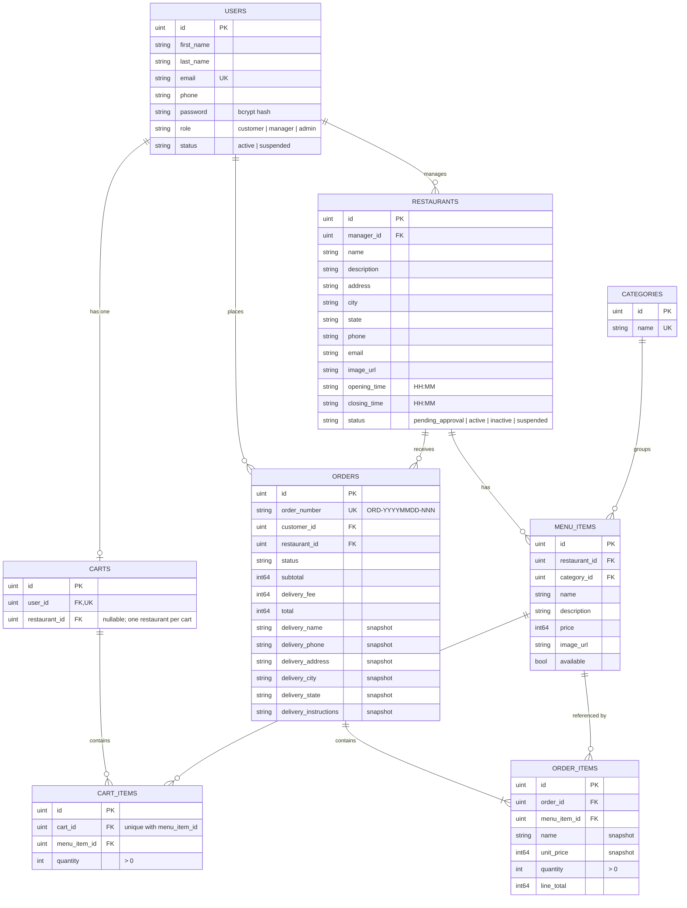

# FoodHub ERD

All tables also have `id`, `created_at`, `updated_at` and `deleted_at` (soft delete) from `gorm.Model`.
Money columns are integers in minor units (kobo/cents).

## Decisions

- **Cancellation rule (PRD 4.8, ORD-06):** an order can be cancelled while it is Pending or Confirmed. Once it is Preparing or later, it can no longer be cancelled (409). Delivered and Cancelled are final states. Customers can cancel their own orders, managers can cancel orders for their own restaurant, and admins can cancel any order. Cancelling uses PATCH /api/orders/{id}/cancel.
- **Order numbers (ORD-01):** every order gets a number in the format ORD-YYYYMMDD-NNN, for example ORD-20261029-001. The number goes back to 001 each day. Checkout works out the next number by finding the highest number used today and adding 1. The order_number column is unique, so if two orders try to use the same number at the same time, that insert is rolled back and checkout tries the next number, up to 5 times.

## Decisions the team still needs to document

- **Cart conflict rule (PRD 4.4):** reject adding an item from a different restaurant, or ask the customer to clear the cart.
